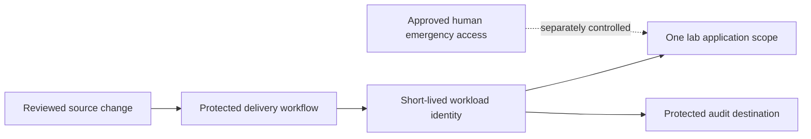

# Cloud IAM: scoped deployment identity

**Type:** platform-neutral design exercise. **Status:** architecture and validation plan only. No AWS account, Azure tenant, policy deployment or successful access test is claimed.

## Business problem and assumptions

A fictional delivery pipeline needs to update one lab application in a non-production environment. A shared administrator credential would create unnecessary impact if compromised. The design separates the developer, delivery system, cloud workload and audit store.

## Trust boundaries

## Control decisions

| Boundary | Design decision | Why it matters |
|---|---|---|
| Source to workflow | Protected change path and explicit environment approval | A trusted repository alone does not make every branch or workflow trusted |
| Workflow to identity | Federated short-lived credentials with exact issuer, audience and subject constraints | Reduces stored secrets and limits which workflow can assume the identity |
| Identity to resource | Explicit actions scoped to one application/environment | Avoids broad role assignment and cross-environment writes |
| Resource to data | Separate deployment rights from reading application secrets and business data | Limits impact of a delivery compromise |
| Actions to evidence | Central audit destination with restricted modification and defined retention | Supports detection, investigation and review |
| Emergency access | Separate time-bound human process with approval and monitoring | Avoids turning an emergency path into routine access |

Provider-specific permissions must be selected from the actual deployment operations. A wildcard policy cannot be justified by this generic diagram. This repository contains no ready-to-deploy policy.

## Validation plan

| Test | Expected result | Evidence to capture in an isolated lab |
|---|---|---|
| Approved workflow, approved environment | Intended deployment succeeds | Identity/session context and deployment event |
| Unexpected repository, branch, audience or issuer | Federation rejected | Denial event and evaluated trust condition |
| Attempt to modify a different application/environment | Denied | Authorization decision and target scope |
| Attempt to read unrelated secrets or assign roles | Denied | Access decision; no secret contents |
| Expired credential or unapproved replay | Rejected according to provider semantics | Timestamp and token/session lifecycle evidence, without token value |
| Audit destination tampering by deployment identity | Denied | Protected audit record |
| Interrupted deployment | Defined recovery path succeeds within a measured target | Recovery record and service health check |

These tests are proposed, not executed. Exact semantics, propagation delays, session expiry and control coverage must be established for the chosen provider.

## Operational ownership

The platform owner maintains the scoped deployment role. Security reviews trust boundaries and detection coverage. The service owner agrees recovery criteria and validates business impact. Audit/compliance stakeholders agree evidence access and retention requirements. Access reviews should remove unused permissions and check changes in scope.

## Residual risks

A compromised approved workflow may still exercise every permission granted to it. Artifact integrity, dependency controls, protected environments, monitoring and scoped recovery remain necessary. Short-lived credentials reduce persistence but do not make a compromised active session harmless.
